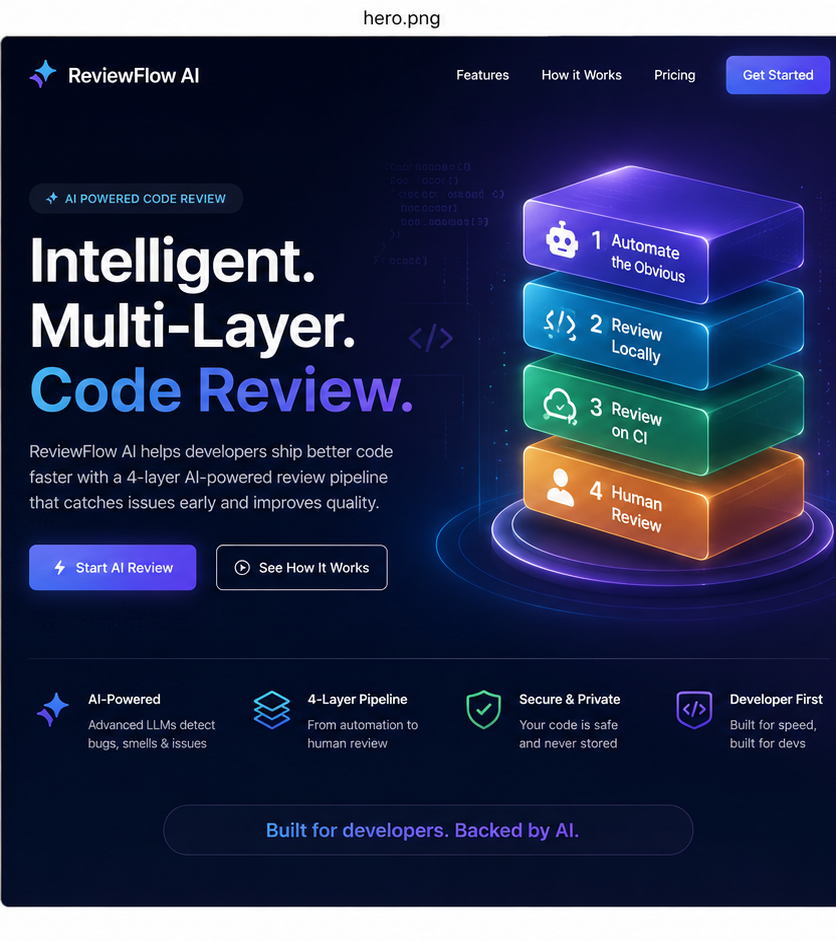
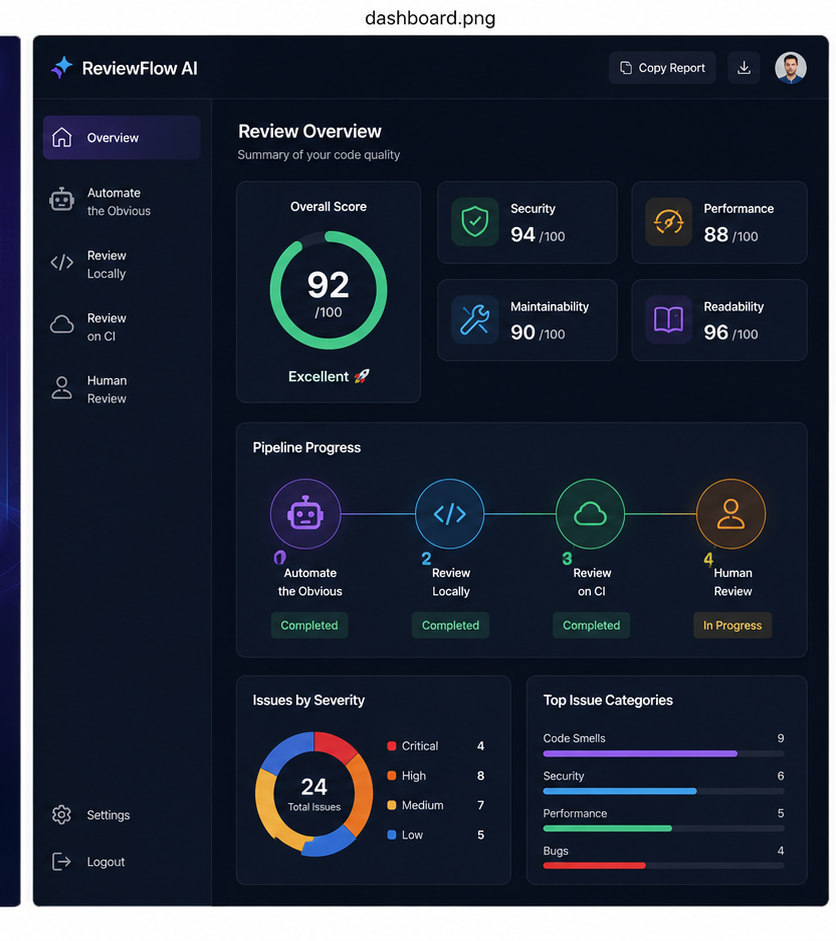

# ReviewFlow AI

### AI-Powered Multi-Layer Code Review Platform

ReviewFlow AI is an AI-powered code review platform that helps developers analyze source code, identify potential issues, and improve code quality through a structured, multi-layer review workflow.

The platform combines a responsive web interface with a Python FastAPI backend and an LLM-powered analysis service to provide code review feedback across different stages of the software development lifecycle.

Rather than treating code review as a single step, ReviewFlow AI organizes the process into four layers — from automated checks to human-oriented review recommendations.

---

## 🚀 Overview

Code review is an essential part of software development, but manual reviews can be time-consuming and inconsistent. Developers may overlook bugs, security concerns, performance issues, or opportunities to improve maintainability.

ReviewFlow AI aims to make this process more structured by using AI to assist developers at multiple review stages.

### Key Features

- **Four-layer review pipeline** for different code review objectives.
- **AI-powered code analysis** using an external LLM API.
- **Multiple programming language support** through language selection.
- **Automated issue identification** for potential bugs and code quality concerns.
- **Security and performance review** to highlight areas requiring attention.
- **Human review assistance** with structured feedback.
- **Progressive response display** for a more interactive review experience.
- **Modular frontend components** for reusable UI functionality.
- **FastAPI backend** for API handling and AI service integration.
- **Dark, responsive interface** designed for a modern developer experience.

---

## 🧠 The Four-Layer Review Pipeline

ReviewFlow AI follows a structured code review workflow.

### 1. Automate the Obvious

Focuses on common programming mistakes and basic code quality issues.

- Identify potential bugs and logical errors.
- Highlight suspicious code patterns.
- Detect unnecessary or problematic code.
- Provide quick feedback on common mistakes.

### 2. Review Locally

Helps developers improve code before committing or pushing changes.

- Improve readability and maintainability.
- Identify code smells.
- Suggest refactoring opportunities.
- Recommend cleaner implementation patterns.

### 3. Review on CI

Focuses on issues that may affect production readiness.

- Highlight potential security concerns.
- Identify performance-related issues.
- Review error handling and validation.
- Suggest improvements to reliability and testing.

### 4. Human Review

Provides review assistance similar to feedback from a developer reviewing a pull request.

- Generate actionable review comments.
- Explain important code concerns.
- Recommend improvements before merging.
- Highlight issues that require human attention.

> AI-generated findings are suggestions, not guarantees. Developers should validate important findings using tests, security tools, and human review.

---

## 🖥️ Application Preview

### Hero Section



### Dashboard



---

## 🏗️ Architecture

```text
                    Developer
                        │
                        ▼
              ReviewFlow AI Frontend
                HTML / CSS / JavaScript
                        │
                        ▼
                 FastAPI Backend
                        │
              ┌─────────┴─────────┐
              │                   │
              ▼                   ▼
        API Endpoints       Request Models
              │                   │
              └─────────┬─────────┘
                        │
                        ▼
                  AI Service
                        │
                        ▼
                 Prompt Builder
                        │
                        ▼
                 External LLM API
                        │
                        ▼
              Review Response Formatter
                        │
                        ▼
               Frontend Review UI
```

### Main Components

| Component | Purpose |
|---|---|
| Frontend | Code input, review interface, and result display |
| FastAPI | Backend application and API routing |
| Request Models | Defines and validates incoming review requests |
| AI Service | Handles communication with the LLM provider |
| Prompt Builder | Builds instructions for different review layers |
| Formatter | Formats generated review content for presentation |

---

## 🛠️ Tech Stack

### Frontend

- HTML5
- CSS3
- JavaScript
- Fetch API
- Modular JavaScript components

### Backend

- Python
- FastAPI
- Pydantic
- Uvicorn

### AI Integration

- Large Language Model API
- Prompt engineering
- Layer-specific code review prompts

### Development Tools

- Visual Studio Code
- Git
- GitHub
- Python virtual environment

---

## 📂 Project Structure

```text
ReviewFlow-AI/
│
├── Frontend/
│   ├── assets/
│   │   ├── icons/
│   │   │   ├── ai-spark.svg
│   │   │   ├── bug.svg
│   │   │   ├── human-review.svg
│   │   │   ├── performance.svg
│   │   │   ├── pipeline.svg
│   │   │   └── security.svg
│   │   │
│   │   ├── images/
│   │   │   ├── dashboard.png
│   │   │   └── hero.png
│   │   │
│   │   └── logo.svg
│   │
│   ├── components/
│   │   ├── code-editor.js
│   │   ├── diff-viewer.js
│   │   ├── fixed-code.js
│   │   ├── loader.js
│   │   ├── navbar.js
│   │   ├── review-card.js
│   │   ├── score-card.js
│   │   └── tabs.js
│   │
│   ├── index.html
│   ├── script.js
│   └── style.css
│
├── app/
│   ├── api/
│   │   ├── __init__.py
│   │   └── review.py
│   │
│   ├── models/
│   │   ├── __init__.py
│   │   └── request_models.py
│   │
│   ├── prompts/
│   │   ├── automate_obvious.txt
│   │   ├── human_review.txt
│   │   ├── master_prompt.txt
│   │   ├── review_ci.txt
│   │   └── review_locally.txt
│   │
│   ├── services/
│   │   ├── __init__.py
│   │   ├── ai_service.py
│   │   ├── formatter.py
│   │   └── prompt_builder.py
│   │
│   ├── __init__.py
│   ├── config.py
│   └── main.py
│
├── .gitignore
├── LICENSE
├── README.md
└── requirements.txt
```

---

## ⚙️ Getting Started

### Prerequisites

Make sure you have installed:

- Python 3.10+
- Git
- Visual Studio Code
- An API key for the LLM provider configured in the backend

### 1. Clone the Repository

```bash
git clone https://github.com/Ahana-Bhattacharya/ReviewFlow-AI.git
```

```bash
cd ReviewFlow-AI
```

### 2. Set Up the Backend

Create a virtual environment:

```bash
python -m venv venv
```

Activate it on Windows PowerShell:

```powershell
.\venv\Scripts\Activate.ps1
```

Activate it on macOS or Linux:

```bash
source venv/bin/activate
```

Install the required packages:

```bash
pip install -r requirements.txt
```

### 3. Configure Environment Variables

Create a `.env` file in the project root or in the location expected by `app/config.py`.

Example:

```env
GROQ_API_KEY=your_api_key_here
GROQ_MODEL=your_model_name
```

Use the exact variable names and model configuration expected by your backend.

**Never commit your API key or `.env` file to GitHub.**

### 4. Run the Backend

From the repository root, run:

```bash
uvicorn app.main:app --reload
```

The backend will start at:

```text
http://127.0.0.1:8000
```

If your FastAPI application exposes interactive API documentation, open:

```text
http://127.0.0.1:8000/docs
```

### 5. Run the Frontend

Open the `Frontend/` folder in Visual Studio Code.

Use the Live Server extension to launch `index.html`.

The frontend will typically be available at:

```text
http://127.0.0.1:5500/Frontend/
```

Make sure the API URL in `Frontend/script.js` points to the backend address:

```javascript
const API_URL = "http://localhost:8000";
```

You can now use the ReviewFlow AI interface to submit code for review.

---

## 🔌 Backend

The backend is built with FastAPI and is organized into modular components.

### API Layer

`app/api/review.py`

Handles code review API requests.

### Request Models

`app/models/request_models.py`

Defines the structure of incoming review requests.

### AI Service

`app/services/ai_service.py`

Handles communication with the configured AI model.

### Prompt Builder

`app/services/prompt_builder.py`

Builds review instructions based on the selected review layer.

### Formatter

`app/services/formatter.py`

Formats generated review responses for the frontend.

### Configuration

`app/config.py`

Manages application configuration and environment variables.

---

## 🧩 Frontend Components

The frontend uses reusable JavaScript components to organize the user interface.

| Component | Responsibility |
|---|---|
| `code-editor.js` | Code input interface |
| `diff-viewer.js` | Code difference visualization |
| `fixed-code.js` | Display of suggested or corrected code |
| `loader.js` | Loading and processing indicators |
| `navbar.js` | Navigation interface |
| `review-card.js` | Review finding presentation |
| `score-card.js` | Code review score display |
| `tabs.js` | Review layer navigation |

---

## 🔐 Security Considerations

ReviewFlow AI follows these security practices:

- Store AI API keys in environment variables.
- Never expose backend API credentials in frontend JavaScript.
- Exclude `.env` files from version control.
- Validate incoming code review requests.
- Configure CORS appropriately for production.
- Avoid logging sensitive source code unnecessarily.
- Treat AI-generated security findings as recommendations requiring verification.

---

## 🎯 Project Goals

- Build a practical AI-powered developer tool.
- Integrate an external LLM API with a web application.
- Apply prompt engineering to software code review.
- Design a modular frontend and backend architecture.
- Improve developer productivity through AI-assisted analysis.
- Explore progressive AI response generation.
- Prepare the application for containerization and cloud deployment.

---

## 📚 Learning Outcomes

This project explores:

- Full-stack web application development
- FastAPI backend development
- LLM API integration
- Prompt engineering
- AI-assisted code analysis
- Frontend/backend communication
- Modular software architecture
- Environment variable and API key management
- Cloud deployment concepts

---

## 👩‍💻 Author

**Ahana Bhattacharya**

CSE (AI/ML) Student

- GitHub: [Ahana-Bhattacharya](https://github.com/Ahana-Bhattacharya)
- Project: [ReviewFlow-AI](https://github.com/Ahana-Bhattacharya/ReviewFlow-AI)

---

## 📄 License

This project is licensed under the terms specified in the [LICENSE](LICENSE) file.

